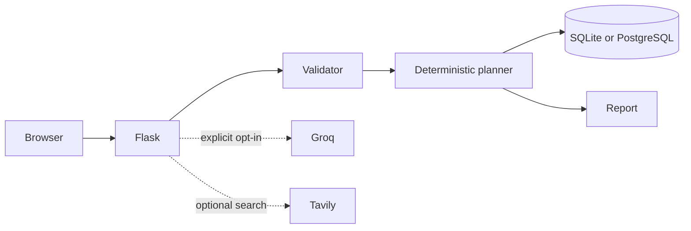

# SmartFin

An open-source financial planning workspace for Indian salaried households. Enter income, expenses, debt, cover, and goals to get a transparent, editable scenario report. **No account or paid API is required.** Optional Groq and Tavily keys add AI explanation and search context.

**[Try the live demo](https://smartfin-advisor.vercel.app/)** · [Read the evaluation](EVALUATION.md) · [View CI](https://github.com/Bitan-2125/Smartfin-Agent-Based-Financial-Advisor/actions/workflows/ci.yml)

[](https://github.com/Bitan-2125/Smartfin-Agent-Based-Financial-Advisor/actions/workflows/ci.yml) [](EVALUATION.md)

## What it does

- Calculates cash flow using take-home pay, expenses, and loan payments; net worth; and an emergency reserve target and gap.
- Models fixed-rate debt payoff and flags payments that do not cover interest.
- Shows life and health coverage gaps against editable starting targets.
- Models up to five goals with inflation-adjusted targets and low, base, and high return scenarios. It displays required monthly funding, projected values, and shortfalls.
- Provides a limited FY 2026–27 Indian salary tax illustration, including entered 80C, self/family 80D, and additional 80CCD(1B) amounts. It does not estimate tax above ₹50 lakh annual salary or handle special-rate income, all exemptions, tax credits, or surcharge.
- Supports editing, JSON export, and deletion of the current plan. Optional AI needs explicit opt-in for each plan; the deterministic report remains available when providers fail.

**Scope:** This is an educational portfolio project, not a SEBI-registered investment adviser. It does not recommend securities or products, connect to banks, or place transactions. Returns are user-editable assumptions, not forecasts. Financial and legal content needs professional review before any public advisory use.

## Evaluation

`python evaluation.py` runs 12 offline behavioral checks and prints a machine-readable score. The checked areas are planning arithmetic (40 points), input quality (10), privacy and data controls (30), and AI safeguards (20). The latest local result is **100/100, 12/12 checks passing**; see the exact rubric and results in [EVALUATION.md](EVALUATION.md). The score measures these engineering checks only. It does **not** measure investment outcomes, model factuality, regulatory compliance, or production readiness.

CI runs both the evaluation and unit tests on each push and pull request. The unit suite currently has 14 tests.

```powershell
python evaluation.py
python evaluation.py --markdown
python -m unittest discover -s tests -v
python smoke_live.py https://smartfin-advisor.vercel.app
```

## Run locally

Requires Python 3.11 or newer. In PowerShell:

```powershell
py -m venv venv
.\venv\Scripts\Activate.ps1
python -m pip install -r requirements.txt
Copy-Item .env.example .env
python -c "import secrets; print(secrets.token_hex(32))"
```

Paste the generated value after `SECRET_KEY=` in `.env`, then run:

```powershell
python app.py
```

Open `http://127.0.0.1:5000/plan`. On Linux or macOS, use `python3 -m venv venv`, `source venv/bin/activate`, and `cp .env.example .env`.

The calculator needs no API key. `GROQ_API_KEY` enables optional AI explanations; `TAVILY_API_KEY` enables optional search. `USE_LLM=false` forces the calculator-only mode. The PDF export button loads browser libraries from a CDN.

## Design and data handling



`planning.py` contains the deterministic calculations. `app.py` handles validation, the Flask routes, and the optional LangGraph flow. `storage.py` stores plans and chat history in SQLite by default or PostgreSQL when `DATABASE_URL` is set. The session cookie holds a random plan token, not financial inputs. Plans expire after seven days and are removed during later plan activity. Recalculating replaces the current browser's plan. The report provides export and delete controls. POST routes use CSRF tokens, and responses include browser security headers.

The database may contain legacy account records from an earlier local version. Account routes are removed; those account-owned plans are not exposed through the anonymous planner. Back up or remove old data deliberately if it exists.

## Deployment

The [live Vercel deployment](https://smartfin-advisor.vercel.app/) uses the Flask runtime, a free Neon PostgreSQL database in Singapore, a stable secret session key, and no paid AI service. `vercel.json` selects the Flask framework and Singapore region. `smoke_live.py` verified the production home page, anonymous planner, plan generation, report, export, and deletion with synthetic inputs; the test plan was deleted. GitHub is connected for automatic deployments from the default branch.

For another Vercel deployment, set a stable `SECRET_KEY`, `SESSION_COOKIE_SECURE=true`, and a private persistent PostgreSQL `DATABASE_URL`. **Do not use SQLite on Vercel:** its functions have [read-only deployment files and temporary scratch storage](https://vercel.com/docs/functions/runtimes), so saved plans would disappear. Vercel [supports a root-level Flask `app` instance](https://vercel.com/kb/guide/ship-a-flask-app-on-vercel), which this repository exports from `app.py`.

For the existing Render service, `Procfile` runs `gunicorn app:app`. Render's [free web filesystem is ephemeral](https://render.com/docs/free), so that service also needs persistent external PostgreSQL for saved plans.

For public use, add an operator privacy policy and contact, backups, monitoring, and review of accessibility and financial content. The included [privacy notice](templates/privacy.html) describes the current app mechanics; it is not a substitute for an operator's legal notice.

## References

- [Income Tax Department: tax rates](https://www.incometaxindia.gov.in/w/tax-rates-and-computation) and [salary deductions](https://www.incometaxindia.gov.in/w/income-from-salary)
- [RBI financial education material](https://www.rbi.org.in/FinancialEducation/content/I%20Can%20Do_RBI.pdf)
- [SEBI investor caution](https://investor.sebi.gov.in/cautiontoinvestor.html) and [investment adviser guide](https://investor.sebi.gov.in/investment_advisor.html)
